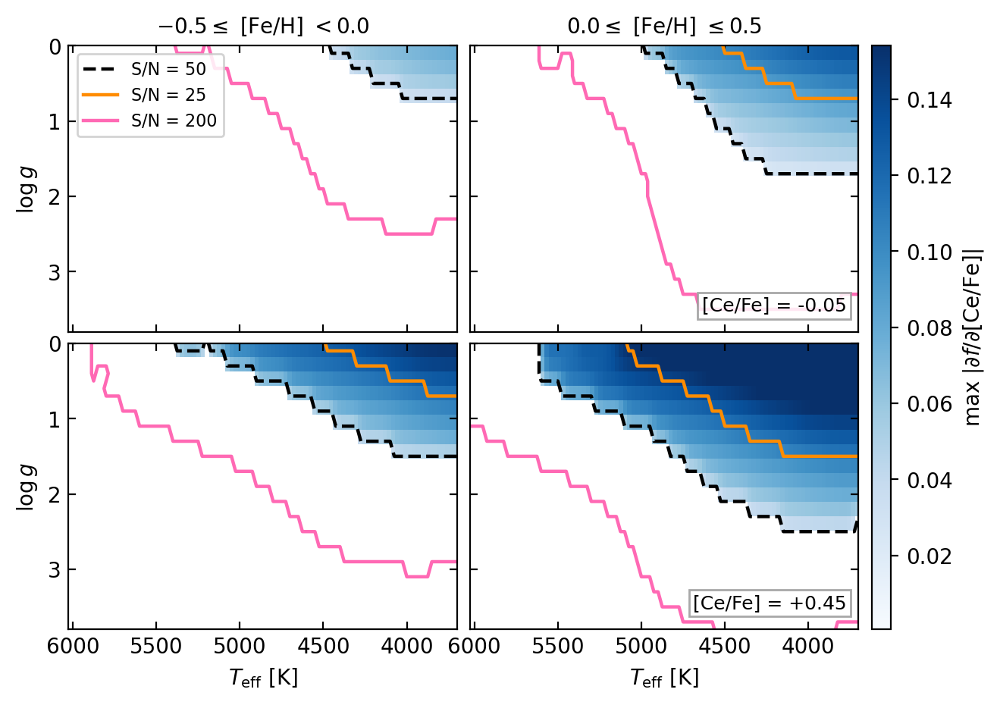

# Ce detectability in *Gaia* RVS spectra

Is the cerium abundance of a star actually measurable from its *Gaia* RVS
spectrum?

This repository answers that for any `(Teff, log g, [Fe/H], [Ce/Fe])` and
signal-to-noise ratio, using the criterion of

> Vitali et al., *Detectability limits of Ce abundances in Gaia RVS*

The Ce II triplet near 851.1 nm is weak and unresolved at the RVS resolving
power (R ≈ 11 500), so a reported [Ce/Fe] is not automatically a measurement.
The tool tells you whether the feature carries usable information for a given
star, and — importantly — reports the two ingredients of that judgement
separately.



## Install

```bash
git clone https://github.com/<user>/ce-rvs-detectability.git
cd ce-rvs-detectability
pip install -r requirements.txt
```

Needs `numpy`, `pandas`, `scipy` (and `matplotlib`, `astropy` for the figures
and the grid tools). No installation step beyond that — the scripts run in place.

## Use

A single star:

```bash
python3 ce_detectability.py --star 4500 1.8 -0.2 0.4 --snr 50
```

```
requested : Teff=4500  logg=1.80  [Fe/H]=-0.20  [Ce/Fe]=+0.40  S/N=50
matched   : Teff=4500  logg=1.80  [Fe/H]=-0.20  [Ce/Fe]=+0.45  (distance 0.50 cells)
            [alpha/Fe] = +0.1 (MARCS standard, fixed by the grid)
CRB       : sigma = 0.072 dex  -> PASS (< 0.1 dex)
EW        : 1.2 sigma            -> FAIL (>= 3 sigma)
==> NOT detectable
```

Arguments to `--star` are in the order `Teff log g [Fe/H] [Ce/Fe]`.

A catalogue — needs columns `teff, logg, feh, cefe`, optionally a per-star `snr`:

```bash
python3 ce_detectability.py --input example_stars.csv --output flagged.csv --snr 50
```

| name | snr | grid_distance | sigma_cefe | ew_snr | crb_pass | ew_pass | detectable |
|---|---|---|---|---|---|---|---|
| cool_giant | 50 | 0.50 | 0.022 | 4.96 | True | True | **True** |
| mild_giant | 50 | 0.50 | 0.072 | 1.22 | True | False | False |
| metal_poor_giant | 50 | 0.71 | 0.050 | 1.39 | True | False | False |
| solar_dwarf | 50 | 0.50 | 1.107 | 0.01 | False | False | False |
| high_snr_giant | 200 | 0.50 | 0.018 | 4.89 | True | True | **True** |

From Python:

```python
from ce_detectability import CeDetectability
ce  = CeDetectability()
out = ce.classify(df.teff, df.logg, df.feh, df.cefe, snr=df.snr)
out[['crb_pass', 'ew_pass', 'detectable']]
```

## The criterion

Two conditions, evaluated at the requested S/N:

| flag | test | question it answers |
|---|---|---|
| `crb_pass` | σ<sub>CRB</sub> < 0.1 dex | does the spectrum carry enough **information** to pin [Ce/Fe]? |
| `ew_pass` | EW ≥ 3 σ<sub>W</sub> | is the **line visible** above the noise? |
| `detectable` | both | the paper's criterion |

with

```
sigma_CRB = 1 / (SNR * sqrt(sum_i g_i^2)),   g_i = df_i/d[Ce/Fe]
sigma_W   = (1.5 / SNR) * sqrt(FWHM * dx),   FWHM = 0.0936 nm, dx = 0.03 nm
```

σ<sub>CRB</sub> is the Cramér–Rao bound (Cramér 1945; Rao 1945), the best precision
any unbiased estimator could reach. σ<sub>W</sub> is the Cayrel (1988) equivalent-width
uncertainty. The equivalent width is integrated against a local linear continuum
taken from the edges of the 851.05–851.25 nm window, so a sloped pseudo-continuum
or a blended neighbour is not counted as Ce absorption.

**Why the two flags are reported separately.** The Cramér–Rao bound sums signal
in quadrature across pixels, so a line can be "statistically detectable" while
its core sits well below the per-pixel noise — a regime highly sensitive to
continuum placement and blending. The Cayrel test is the reality check. Stars
with `crb_pass=True, ew_pass=False` are exactly that marginal population
(`mild_giant` above), and deserve separate treatment rather than being merged
into the non-detections.

Both limits scale as 1/SNR, so any S/N is obtained by rescaling the tabulated
S/N = 50 reference.

## Output columns

| column | meaning |
|---|---|
| `crb_pass`, `ew_pass`, `detectable` | the three flags above |
| `sigma_cefe` | Cramér–Rao bound on [Ce/Fe] at your S/N, dex |
| `ew_ce`, `ew_limit` | measured EW and the 3σ threshold, nm |
| `ew_snr` | detection significance, in σ (the test is ≥ 3) |
| `grad_rss` | √(Σ g<sub>i</sub>²), the Ce sensitivity of the spectrum |
| `*_grid` | the grid node the star was matched to |
| `grid_distance` | distance to that node, in grid cells |
| `alpha_assumed` | the [α/Fe] implied by [Fe/H] (see below) |
| `in_grid_range` | False if the star lies outside the grid's coverage |
| `delta_cefe` | [Ce/Fe] step of the finite difference (normally 0.1) |

## Two things to watch

**`grid_distance`** is measured in grid cells (Teff/25 K, log g/0.2 dex,
[Fe/H]/0.1 dex, [Ce/Fe]/0.1 dex). 0 means the star sits on a node, up to ~0.5
that it sits between nodes. The criterion is a **step function** at the boundary,
so a star with `grid_distance` ≳ 0.5 landing near the contour is genuinely
ambiguous — flag it rather than quoting a hard yes/no. `in_grid_range` catches
stars outside the grid entirely; those are snapped to the nearest edge node and
should not be trusted.

**[α/Fe] is not a free parameter.** The synthesis fixed it to the standard MARCS
metallicity-dependent relation (+0.4 for [Fe/H] ≤ −1, falling linearly to 0.0 at
[Fe/H] ≥ 0), so it is determined by [Fe/H] and cannot be supplied. The tool
reports the assumed value in `alpha_assumed`. A star whose true [α/Fe] departs
from that relation is not covered: α-enhancement deepens the blends that set the
local pseudo-continuum and suppresses the measured Ce EW, so the boundary shifts
slightly. The effect is subdominant to continuum-placement error over a realistic
thin/thick-disc spread, but it is not zero.

## Grid coverage

| axis | range | step |
|---|---|---|
| Teff | 3700 – 6025 K | 25 K |
| log g | 0.0 – 4.8 | 0.2 |
| [Fe/H] | −2.0 – +0.5 | 0.1 |
| [Ce/Fe] | −0.5 – +2.0 | 0.1 |

61 100 (Teff, log g, [Fe/H]) nodes, 1 527 482 table entries.

Gradients are finite differences between consecutive [Ce/Fe] values, so the
tabulated [Ce/Fe] are **midpoints** (±0.05, ±0.15, …). A request for
[Ce/Fe] = 0.0 matches the −0.05 or +0.05 midpoint; the figures are labelled with
the midpoint actually used. In 16 of the 1 527 482 entries a synthesis is
missing, so the difference spans 0.2 dex instead of 0.1 — see `delta_cefe`.

## How the table was produced — and how to run it on your own spectra

`data/ce_detectability_table.csv.gz` is derived from a grid of **1 588 582
synthetic spectra** computed with Turbospectrum (Alvarez & Plez 1998; Plez 2012),
MARCS model atmospheres (Gustafsson et al. 2008), the Gaia-ESO v6 line list
(Heiter et al. 2021) with hyperfine structure and isotopic splitting, and the
solar scale of Grevesse et al. (2007), convolved to R = 11 500 and sampled at
0.001 nm. Microturbulence was 1 km/s for dwarfs and 2 km/s for giants; no
rotation or macroturbulence. Full details in Appendix A of the paper.

That grid is ~37 GB and is not distributed here — but `compute_gradients.py`,
the script that turned it into the shipped table, is. **It runs directly on a
directory of synthetic spectra**, so if you have computed your own grid you can
produce a detectability table for it:

```bash
python3 compute_gradients.py /path/to/your_spectra -o my_table.csv.gz
```

and then point the lookup at the result:

```bash
python3 ce_detectability.py --table my_table.csv.gz --star 4500 1.8 -0.2 0.4 --snr 50
```

### Try it: example spectra

Six synthetic spectra from the grid are included in `data/ex_synth_spectra/`, so
the pipeline can be run end to end without downloading anything:

```bash
python3 compute_gradients.py data/ex_synth_spectra -o example_table.csv
```

```
window    851.05-851.25 nm
criteria  sigma < 0.1 dex  |  EW >= 3 sigma_W = 0.004769 nm   (at S/N = 50)
6 spectra, 4 (Teff, logg, [Fe/H]) nodes
  WARNING: 2 of 4 nodes have a single [Ce/Fe] value and yield no gradient -- they are skipped
  NOTE: [Ce/Fe] steps present: [0.6]. ...
wrote example_table.csv: 2 rows, detectable 1 (50.0%)
```

| Teff | log g | [Fe/H] | [Ce/Fe] | σ<sub>CRB</sub> | EW | crb_pass | ew_pass | detectable |
|---|---|---|---|---|---|---|---|---|
| 4500 | 1.0 | −0.2 | 0.5 | 0.032 | 0.00623 | True | True | **True** |
| 5500 | 3.0 | −0.2 | 0.5 | 0.279 | 0.00015 | False | False | False |

The contrast is the point: at the same metallicity and Ce abundance, the cool
giant is comfortably detectable and the warm subgiant is not, by two orders of
magnitude in equivalent width.

Two caveats, which the script warns about. These six spectra sample four nodes,
two of which have a single [Ce/Fe] value and so yield no gradient. The other two
span [Ce/Fe] = 0.2 → 0.8, a **0.6 dex step** rather than the 0.1 dex of the full
grid, so the derivative is coarser than the one behind the shipped table and the
numbers above are a demonstration, not a reproduction of it. A production run
wants a node sampled at the grid's own [Ce/Fe] spacing.

### Input format

One spectrum per file, named so the parameters can be read back:

```
synth_teff4500_logg1.0_feh-0.2_cefe0.4.txt

    wave      flux            <- one header line
    851.000   0.998732
    851.001   0.998698
    ...
```

A one-line header, then two tab-separated columns: wavelength in nm and
continuum-normalised flux, on a fixed wavelength step. For a different naming
convention, edit `FNAME_RE` at the top of the script. A FITS grid is also
accepted (see the script's docstring).

### Every choice is a command-line option

The numbers behind the criterion are **choices, not constants** — the defaults
reproduce the paper, and all of them can be changed:

| option | default | what it controls |
|---|---|---|
| `--wmin`, `--wmax` | 851.05, 851.25 nm | the gradient window |
| `--n-edge` | 5 px (2.5% of the window) | how much of the window defines the local linear continuum |
| `--snr` | 50 | reference S/N; both limits scale as 1/SNR, so results rescale to any other |
| `--target-sigma` | 0.1 dex | the CRB precision threshold — what "measurable" means |
| `--fwhm` | 0.0936 nm | line FWHM, sets the Cayrel limit |
| `--dx` | 0.03 nm | the **instrument** pixel, not the sampling of your spectra |
| `--n-sigma` | 3 | EW detection significance — what "visible" means |

So a stricter detection on a wider window, at higher S/N, is just:

```bash
python3 compute_gradients.py my_spectra -o strict.csv \
    --wmin 851.00 --wmax 851.30 --snr 100 --target-sigma 0.05 --n-sigma 5
```

`python3 compute_gradients.py --help` lists them all with their defaults.

Two things worth knowing if you change them. `--dx` is the pixel of the
*instrument* you are simulating (0.03 nm for RVS), not the sampling of your
synthetic spectra — the Cayrel limit is about the pixels the detection would
actually be made on. And the gradient step comes from your grid's own [Ce/Fe]
spacing, not from an option: the script differences consecutive abundances at
each node, so the spacing of your grid sets the resolution of the derivative.

## Figures

```bash
python3 plot_detectability.py
```

writes `figures/fig2_detectability.png` and `figures/figC1_detectability.png`,
the detectability maps across the Kiel diagram for several metallicity and
[Ce/Fe] bins, with contours at S/N = 25, 50 and 200.

## Caveats

The boundary assumes a perfectly known continuum and exact atmospheric
parameters. It neglects continuum-placement bias (which dominates above ~1%
error), uncertainties in Teff and log g, and is derived from synthetic spectra
rather than from the output of any particular pipeline. Treat it as a guide to
where Ce abundances *can* be trusted, not as a per-star error bar.

## Citation

If you use this, please cite the paper:

```bibtex
@article{vitali_ce_rvs,
  author  = {Vitali, S. and others},
  title   = {Detectability limits of Ce abundances in Gaia RVS},
  journal = {Astronomy \& Astrophysics},
  year    = {2026}
}
```

## Licence

MIT — see `LICENSE`.
